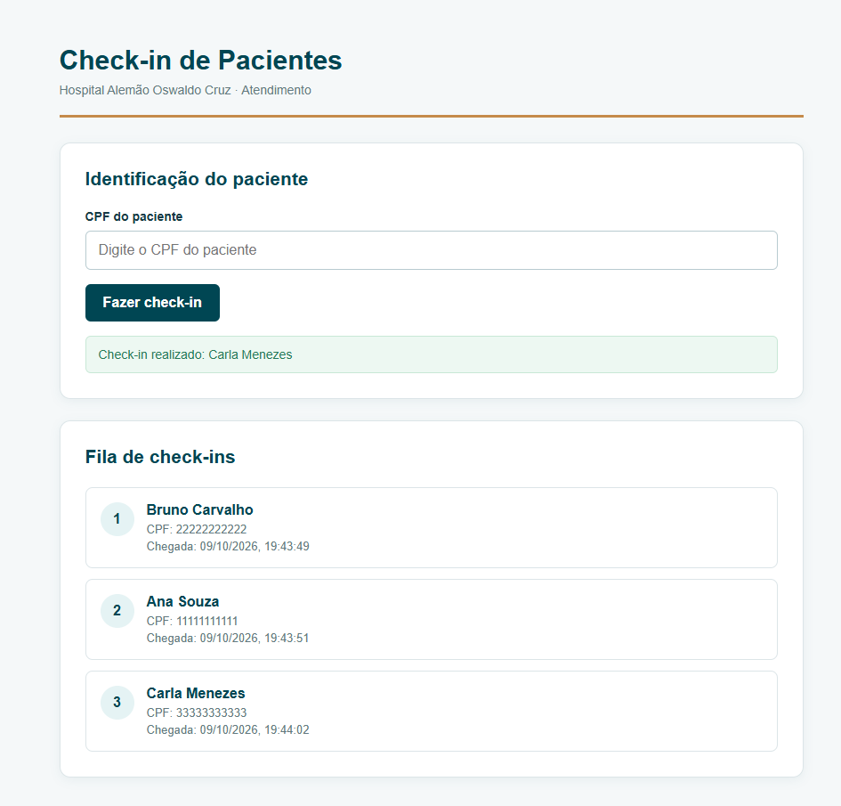

# Entrega — Giselle Costa

> Preencha este arquivo. Ele nos ajuda a rodar e entender o seu projeto.

## Como rodar

### Pré-requisitos
- Git instalado.
- Docker e Docker Compose instalados e em execução.
- Portas `4000`, `3000` e `5173` liberadas na máquina.

### Passo a passo
1. Clone o repositório:
   ```bash
   git clone <URL_DO_REPOSITORIO>
   ```

2. Entre na pasta raiz do projeto:
   ```bash
   cd <NOME_DA_PASTA>
   ```

3. Suba todos os serviços com o Docker Compose:
   ```bash
   docker compose up --build
   ```

4. Aguarde a inicialização e acesse:
   - **mock-service:** `http://localhost:4000`
   - **API:** `http://localhost:3000`
   - **Web:** `http://localhost:5173`

5. Abra o navegador em `http://localhost:5173` para usar a aplicação.

Para parar os serviços, pressione `Ctrl + C` no terminal ou execute em outra aba:
```bash
docker compose down
```

## O que foi feito
O primeiro passo foi a etapa de planejamento. Fiz a leitura do desafio e a análise do repositório para entender o que precisava ser desenvolvido e a ordem de prioridade. 
Além disso, tomei as primeiras decisões técnicas para implementação. 

Após isso, fiz a implementação da lógica da fila, integração com o mock-service, desenvolvimento de testes unitários para validação e implementação dos últimos componentes da API.

Por fim, desenvolvi o front-end, inicialmente simples, mas depois evolui para uma interface mais amigável. Também criei os arquivos de infraestrutura para utilizar o Docker. 



## Onde guardei os dados
Decidi armazenar os dados em memória. A explicação está a seção "Decisões e dificuldades".

## Decisões e dificuldades

### Decisões
- A fila é o componente mais importante do desafio em minha opinião. Antes de pensar em controller, front-end, etc, gostaria de abordar a solução da fila e criar os testes que validem o funcionamento esperado dela. Por conta disso, apesar de os testes serem requisitos desejáveis, irei tratá-los como necessários para o escopo mínimo.

- Decidi subir o projeto com Docker para garantir a reprodutibilidade na máquina do avaliador. Entendo que o custo de implementação do Docker é baixo em relação aos benefícios de facilitar a configuração.

- Irei armazenar os dados em memória para este desafio. Vou priorizar o desenvolvimento da fila e das regras de negócio, evitando gastar tempo com a infraestrutura do banco de dados. Entretanto, isso só é valido para o desafio. Em produção, a aplicação deve ser desenvolvida utilizando um banco de dados relacional para garantir a persistência da informação, além de armazenar um histórico de operações para fins de auditoria, e outros benefícios. 

- Fiz a validação dupla de CPF, ela acontece tanto no back-end como no front-end. No front-end é importante para dar o feedback imediato de que o cpf está incorreto ao usuário. Já no back-end, é necessário para garantir a integridade do dado, especialmente caso a barreira do front-end seja burlada. 

### Dificuldades
- Tive dificuldades em executar o projeto localmente por ter optado pela infraestrutura do Docker. Ainda não resolvi o conflito por conta do tempo, mas o projeto deve rodar com Docker ao seguir o passo a passo documentado. De maneira geral, a implementação da infraestrutura sempre é mais desafiadora do que escrever a lógica de negócio. 

- Tem um WARNING em tsconfig.json que ainda não consegui resolver, também por conta do tempo, e está relacionado ao conflito de infraestrutura local e Docker, mas isso não impede a execução do projeto. 

- Pensando mais em lógica e regras de negócio, a questão de concorrência de check-ins exige um pouco mais de raciocínio. Optei por seguir uma abordagem simples por se tratar de um desafio rápido. 

## O que faria com mais tempo

- Resolveria os conflitos para executar tanto localmente quanto via Docker.

- Migraria o projeto para utilizar um banco de dados relacional (PostgreSQL). Como disse em outra seção, em produção, garantir a persistência e a confiabilidade dos dados é um requisito obrigatório. 

- Tratamento de race conditions e concorrência. Pensei nisso porque, na UBS que frequento, existem dois totens para os pacientes fazerem o check-in. Por isso, seria importante garantir que o sistema funcione corretamente quando dois check-ins acontecem ao mesmo tempo, evitando registros duplicados de um mesmo paciente e garantindo que a fila mantenha a ordem correta de chegada. 

- Apesar de ter criado um teste de duplicidade, não é suficiente para garantir idempotencia. O banco de dados seria ideal para garantir transações atômicas e criar chaves idempotentes fortes. Eu implementaria esses padrões.
